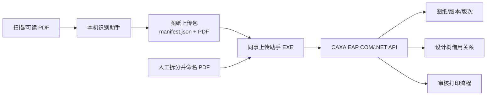

# 扫描图纸处理与 CAXA 上传工具架构说明

## 1. 评审目的

请重点评审以下问题：

1. “本地视觉识别”和“可分发的 CAXA 上传”按当前边界拆分是否合理；
2. 上传包和人工次级条目关系的数据模型是否稳健；
3. CAXA 多对象操作缺少事务时，失败恢复和幂等应如何设计；
4. 对于旧版 CAXA 2011 COM/.NET 接口，是否应采用服务层、CLI 或插件架构；
5. 如何降低 Windows 弹窗自动确认和运行时环境差异带来的脆弱性。

## 2. 业务背景

输入是扫描或可读的工程图 PDF。输出是：

- 按单页拆分的 PDF；
- 文件名“图号 名称.pdf”；
- CAXA 图纸及其版本/版次；
- 按整机总装 BOM 或人工指定关系建立的借用链接；
- 可选的“审核打印”流程。

旧流程把视觉识别、人工补录、CAXA 上传、版本策略、流程发起全放在一个
Python Tk 程序中。现在拆分成两个工具：



## 3. 两个程序

### 3.1 图纸识别助手（仅本机）

入口：`recognize_main.py` / `启动识图助手.bat`

- 调用本机 Qwen 视觉服务；
- 拆页、识别、自动合并连续两页；
- 输入可读原图或可读总装图时，用文本层辅助补全；
- 读取总装图 BOM，生成借用建议；
- 人工核对后导出便携上传包。

不负责 CAXA 上传。

### 3.2 图纸上传助手（可分发）

入口：`upload_main.py` / `图纸上传助手.exe`

- 不导入 `pipeline`、`PIL`、`pdfplumber`、`pypdf`、PyMuPDF 或 Qwen；
- 可以打开识别助手生成的上传包；
- 也可以接收人工拆分并命名的 PDF；
- 在表格内拖动 PDF 行建立父级/次级条目关系；
- 右键 PDF 可增加次级条目；
- 次级条目可从本批 PDF 下拉选择，也可手输设计树已有图号；
- 上传图纸，可选上传全部成功后发起“审核打印”流程。

## 4. 上传包协议

目录：

```text
图纸上传包_YYYYMMDD_HHMMSS/
├── manifest.json
└── drawings/
    ├── 图号 名称.pdf
    └── ...
```

`manifest.json` 关键字段：

```json
{
  "schema": "caxa-drawing-upload-bundle",
  "schema_version": 1,
  "items": [
    {
      "file": "drawings/01.59.OV.03 焊接管路包.pdf",
      "sha256": "...",
      "size": 402266,
      "source": "...",
      "page": 1,
      "code": "01.59.OV.03",
      "name": "焊接管路包",
      "machine": "",
      "kind": "component",
      "borrow": false,
      "upload_sel": true,
      "status": "待上传"
    }
  ],
  "assemblies": [
    {
      "machine": "03.OV.04-05030",
      "codes": ["01.70.WVS-304", "01.55.04.45E(L)DN40-XS-304"]
    }
  ],
  "relations": [
    {
      "parent_code": "01.59.OV.03",
      "child_code": "01.59.OV.03-03"
    }
  ],
  "manual_borrows": [],
  "warnings": []
}
```

`relations` 和 `manual_borrows` 用于人工建立次级条目；`assemblies` 保留识别端
从 Z03 总装图提取的 BOM。

## 5. 识别流程

1. `pypdf` 按页拆分。
2. `pypdfium2` 渲染每页为 PNG。
3. 本地 Qwen 先做整页字段转录。
4. 对可疑组件，再裁剪标题栏放大识别。
5. 可用可读 PDF 文本层做候选匹配。
6. 连续两页同图号时自动合并。
7. 若识别到 Z03 总装图，提取材料明细表作为借用候选。
8. 人工核对。
9. 将结果 PDF 复制为“图号 名称.pdf”，写入上传包。

识别核心：`pipeline/recognize_core.py`。

## 6. 上传流程

主流程位于 `upload_core.py`，底层为 `caxa/uploader.py`：

1. 登录 CAXA。
2. 按图号查人员 ID。
3. 按父子依赖排序上传。
4. 整机图纸优先创建/找到整机零件。
5. 工艺文档挂接到整机零件。
6. 组件图纸挂接到对应零件，必要时按图号前缀创建缺失 Part。
7. 上传文件；遇到重复对象时按策略处理。
8. 全部上传成功后处理 BOM 借用和人工次级条目关系。
9. 可选调用 `start_workflow`。

上传失败时：

- 不发起流程；
- 保留逐项结果；
- 不自动删除已上传文件；
- 不自动回滚 CAXA 对象。

## 7. 重复图号与升版

文件导入遇到重复对象时，CAXA 弹出：

> 对象已经存在提示框

默认策略 `append_iteration`：

- 选择“在现有版本上追加新的版次”；
- 勾选“应用到所有”；
- 点击“确定”。

该 UI 自动确认由 `caxa_helper.cs` 的后台线程执行。

捕获到的对象变化：

- 复用原 `drawing(1002)` 和 `drawingRev(3220)`；
- 新建 `drawingItr(3221)`；
- 新建 `File(3064)` 与 `vaultfile(3066)`；
- 新建 `drawingRevcmp(3224)` 与 `drawingItrfile(3225)`。

另一种策略 `reuse` 直接复用已有文档。旧策略 `new_version` 采用
检出、覆盖文件和检入，不等同于前端重复对象对话框。

## 8. CAXA 工作流接口

已确认：

- 模板对象 `WFTemplate(1) “审核打印”`
- 流程模板实例 `WFProcessTemplate(31)`
- 流程定义 `process_def_id="2"`
- 审核活动 `activity_def_id="4"`
- 审核人 `Person(66) “审核人”`
- 示例用户 Person ID `108`

图纸关联：

- `WFInstObjDocument`
- classid `3305`
- 流程端 role `WFInstanceWithDocument`
- 文档端 role `DocumentOfWFInstance`

审核人关系：

- `WFWorkitemPerform`
- classid `2593`
- 工作项端 role `AssignmentOfPerson`
- 人员端 role `AssignmentPerform`

真实流程 `16289` 已读回：

- 6 张关联图纸；
- 审核活动 `79123` 运行中；
- 工作项 `48227` 指向 `Person(66)`；
- 流程状态 `2 OPEN__RUNNING`。

## 9. 次级条目和借用

程序区分两类数据：

### 识别包自动 BOM

识别端从 Z03 总装图提取 `assemblies[].codes`。上传后：

- 本批没有该组件的 PDF 时，在 CAXA 中找到已有 Part；
- 建立整机零件到组件的引用链接；
- 不新建缺失节点。

### 人工次级条目

上传端先导入整批 PDF，然后允许：

- 在 PDF 列表中把一个 PDF 行拖到另一个 PDF 行；
- 右键父 PDF，选择“增加次级条目”；
- 从本批 PDF 下拉选择子项；
- 或直接输入 CAXA 设计树已有子图号；
- 一个子项可添加多个父级关系。

关系直接显示在“上传图纸”层级树中，结构为：

```text
01.59.OV.03 焊接管路包
├── 01.59.OV.03-03 二级缸进气管 [本批 PDF]
└── 01.34.XX.XXX        某组件 [设计树借用]
```

提交时，先按关系做父先子后的排序；上传结束后，对已有 Part 建立
引用链接。父级或子级不存在时跳过，不自动新建。

## 10. 文件名规则

上传端要求：

```text
图号 名称.pdf
```

示例：

- `01.59.OV.03 焊接管路包.pdf`
- `01.36.02.OV-11B 一级气水分离器.pdf`

不符合规则的行会标红并禁止勾选上传。图号匹配支持：

- `01.`、`02.`、`04.` 开头；
- `03.` 整机图纸；
- `Z03.*` 总装工艺文档；
- `ZJ03.*` 工艺文档，并从其中的 `03.*` 推导整机代码；
- 单字母前缀工艺文档，例如 `J03.*`、`M03.*`、`P03.*`、`T03.*`。

## 11. 当前安全措施

- `start_workflow` 默认 `execute=false`；
- 只有全部选中项上传成功才发起流程；
- 不自动删除 CAXA 已有对象；
- 不自动创建 BOM 借用中缺失的节点；
- 分发包不含账号密码和抓包文件；
- 密码用 Windows DPAPI 保存。

## 12. 已验证内容

- Qwen 识别和旧版完整流程曾真实跑通；
- 6 张升级图纸真实上传并关联到流程 `16289`；
- 6 次 `CreateID(3305)` 与 6 张图纸对应；
- 分发包可启动，内置 helper 可加载；
- 分发包归档中确认无 `pipeline/vision/PIL/pdfplumber/pypdf/PyMuPDF`；
- PDF 文件名解析、非法名称标记、上传包导入导出、父子关系树逻辑通过
  单元/冒烟测试；
- helper 编译通过。

## 13. 尚未真机验证

- 新拆分后上传助手执行真实图纸上传；
- `append_iteration` 在实际 dry-run 场景下自动点击三步骤；
- 人工次级条目在真实 CAXA 设计树中的引用链接；
- ZJ 工艺文档的实际挂接；
- 新 helper 创建流程并启动的完整链路；
- 失败后的人工恢复和幂等检查。

## 14. 主要风险

1. **跨多个 CAXA 对象不是事务性的。** 上传完成、借用关系完成、流程创建
   分别可能成功或失败，需要明确恢复策略。
2. **UI 自动确认依赖中文控件文本。** CAXA 版本、语言或布局变化会导致失败。
3. **流程重复检测不足。** 当前主要靠“上传失败不发起”和工作习惯避免重复；
   还没有按关联 Drawing 集合检查已有运行流程。
4. **人工关系语义需确认。** 当前统一使用引用链接
   `link_part(reference=true)`；对“归属子件”和“借用子件”的差异是否应区分，
   需要用真实设计树确认。
5. **ZJ 编码规则是启发式。** `ZJ` 后的整机代码可能采用不同命名方式，
   无法解析时应要求人工补全成品代码。
6. **分发包依赖本机 CAXA DLL。** helper 从固定安装路径加载
   `EAP 2011r3` 接口，不同 CAXA 版本或位数可能不兼容。
7. **单文件 EXE 首次启动解压到临时目录。** helper 已嵌入，但企业安全软件
   可能拦截 PyInstaller 单文件程序。

## 15. 建议评审方向

1. 是否把 CAXA helper 改为更明确的本地服务/CLI，由上传 UI 通过 JSON-RPC
   调用，减少进程协议和 UI 耦合。
2. 是否建立持久化操作日志和可重放的“操作计划”，支持上传、关联、流程三个
   阶段分别恢复。
3. 是否用父级/子级关系表替代当前 `relations + manual_borrows + assemblies`
   三套来源，统一生成计划和展示。
4. 是否在发起流程前查询关联 Drawing 集合，实现幂等防重。
5. 是否把弹窗自动确认改为 CAXA 安装目录中的配置或导入 API 参数，消除 UI
   自动化。
6. 是否把识别结果包升级为带签名的工程包，加入 schema 校验、版本迁移和
   PDF 哈希校验。
7. 是否区分“拥有关系”“借用关系”“流程关联”三类关系，分别记录来源和
   可撤销操作。

## 16. 关键文件

- 识别入口：`recognize_main.py`
- 上传入口：`upload_main.py`
- 上传编排：`upload_core.py`
- 识别包协议：`drawing_bundle.py`
- CAXA 业务编排：`caxa/uploader.py`
- helper 协议：`caxa/bridge.py`
- CAXA 原生调用：`caxa/caxa_helper/caxa_helper.cs`
- 识别核心：`pipeline/recognize_core.py`
- 打包脚本：`build_split_packages.ps1`
- 抓包与分析：`../work/caxa_workflow_capture_analysis_20261105.md`
